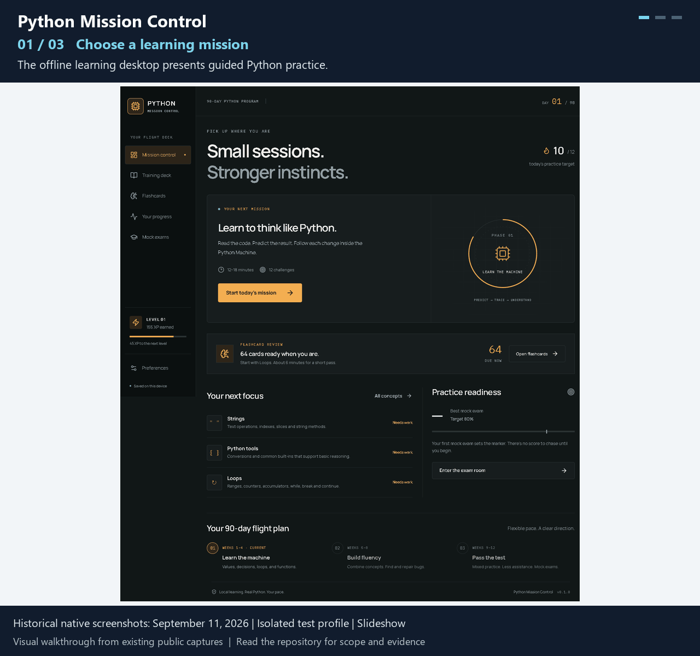
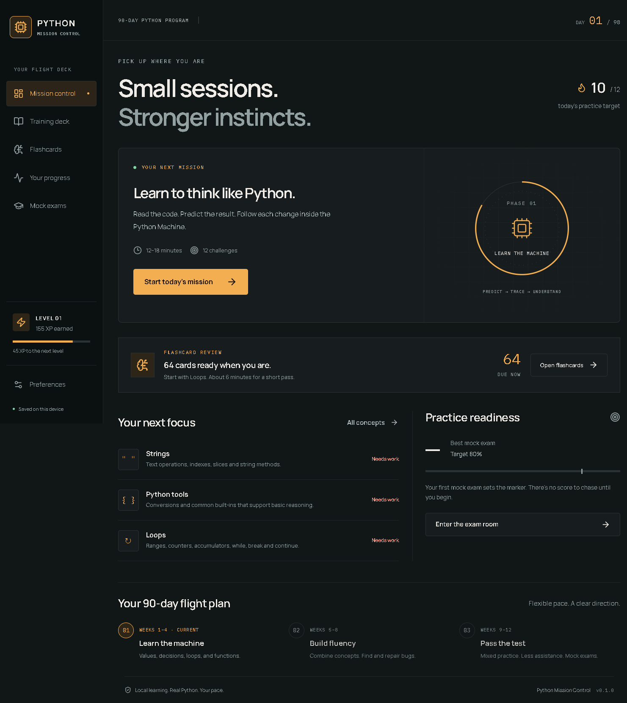

# Python Mission Control

**Offline Python-learning desktop application with real execution tracing.**

*15-second looping slideshow of the existing public images. Historical native screenshots: September 11, 2026 | Isolated test profile | Slideshow.*

A learner needs to predict what Python will do, inspect the state changes and return to practice without losing progress. Python Mission Control combines lessons, debugging exercises and review scheduling in a native Windows application. It is a Python-learning product, not a business operations console.

*Historical native capture, September 11, isolated test profile. Fresh native verification was not performed.*

**Status:** Public application source; fresh CPython component demo; historical native evidence.

[Walkthrough](docs/WALKTHROUGH.md) · [Technical explanation](docs/ARCHITECTURE.md) · [Validation scope](docs/EVIDENCE.md)

## From input to output

A learner chooses and locks a prediction before seeing execution and explanation. The Python Machine shows actual statement, branch and variable-state events. In the fresh component demonstration, a loop over 2, 3 and 4 accumulates and prints 9; the CPython helper returns the corresponding trace. Native screenshots below come from a retained September verification run.

## My contribution

I shaped the learning sequence, curriculum boundaries, feedback timing and persistence requirements. I directed AI-assisted React, Tauri and Python implementation and used independent review and agent-run checks to assess behavior. The project is separate from my paid support employment.

## Architecture and decisions

React and TypeScript own the interface and deterministic learning logic. The Rust Tauri host starts a bundled Python helper without an arbitrary shell command and owns transactional local storage. CPython performs the operations; AST validation, instrumentation and sys.settrace produce bounded events. Local progress uses SQLite and retained snapshots.

- Require a prediction before feedback: the flow encourages active code reasoning, while assessment modes defer feedback until submission.
- Use real Python instead of simulated arithmetic: this makes execution semantics inspectable, but requires a packaged runtime and a carefully bounded helper protocol.
- Keep progress on the device: no account or runtime AI service is required. Recovery and profile isolation must be tested explicitly, and practice scores are not validated mastery claims.

## Validation

Fresh tracing against source commit e008d51850bff82d885e2ddb26cedcabeeaaa00a produced output 9 with real execution events and no error. Retained desktop-smoke evidence dated September 11 documents bundled CPython, isolated SQLite, prediction/tracing behavior and assessment persistence after restart. That evidence is historical. Native interaction and restart were not rerun in this task because native computer capture/control is unavailable.

## Failure and human review

The host and helper bound code size, operations, steps, recursion, output and elapsed time. Errors remain visible; this is controlled curriculum execution, not a secure general-purpose code sandbox. The startup-only PMC_PROFILE_DIR contract isolates both storage and WebView state. Use an absolute local test directory and preserve the normal learner profile.

## Limitations

The fresh helper run proves a component boundary, not current packaged-native integration. Historical screenshot values are test-profile values, not learning outcomes for real users. The app requires Windows and an installed WebView2 runtime. A browser-only frontend cannot establish native storage or Python execution.

## Inspect or run

Existing native launch and build instructions remain in docs/INSTALLATION.md. Keep the portable executable beside its bundled mission-python resources. Read the walkthrough and evidence before interpreting historical screenshots as current validation.
