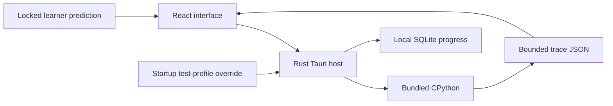

# Python Mission Control: architecture

React and TypeScript own the interface and deterministic learning logic. The Rust Tauri host starts a bundled Python helper without an arbitrary shell command and owns transactional local storage. CPython performs the operations; AST validation, instrumentation and sys.settrace produce bounded events. Local progress uses SQLite and retained snapshots.

- Require a prediction before feedback: the flow encourages active code reasoning, while assessment modes defer feedback until submission.
- Use real Python instead of simulated arithmetic: this makes execution semantics inspectable, but requires a packaged runtime and a carefully bounded helper protocol.
- Keep progress on the device: no account or runtime AI service is required. Recovery and profile isolation must be tested explicitly, and practice scores are not validated mastery claims.

This diagram is a conceptual architecture visual, not a runtime screenshot.

