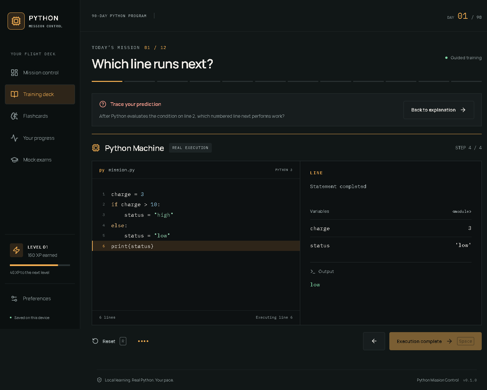
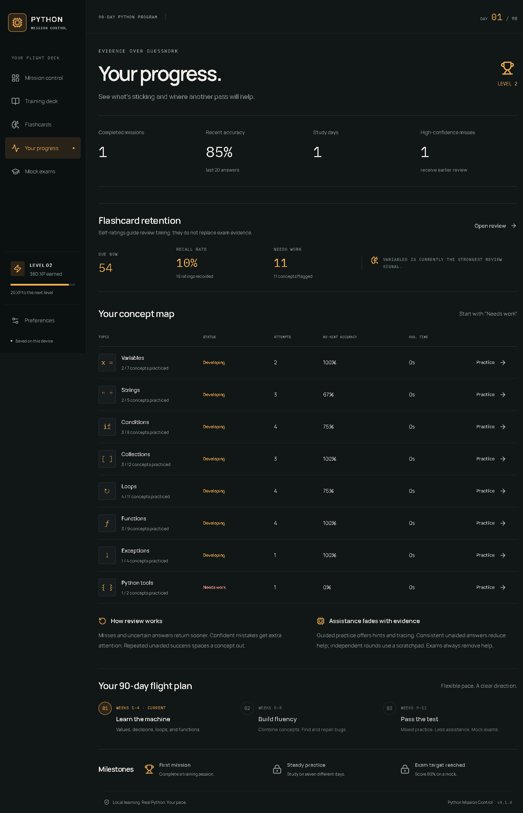

# Demonstrated scope

Fresh tracing against source commit e008d51850bff82d885e2ddb26cedcabeeaaa00a produced output 9 with real execution events and no error. Retained desktop-smoke evidence dated September 11 documents bundled CPython, isolated SQLite, prediction/tracing behavior and assessment persistence after restart. That evidence is historical. Native interaction and restart were not rerun in this task because native computer capture/control is unavailable.

The fresh helper run proves a component boundary, not current packaged-native integration. Historical screenshot values are test-profile values, not learning outcomes for real users. The app requires Windows and an installed WebView2 runtime. A browser-only frontend cannot establish native storage or Python execution.

## Capture labels

Historical native capture, September 11, isolated test profile. Fresh native verification was not performed.

*Historical native capture, September 11, isolated test profile. Fresh native verification was not performed.*

*Historical native capture, September 11, isolated test profile. Fresh native verification was not performed.*

*Historical native capture, September 11, isolated test profile. Fresh native verification was not performed.*

The figures are evidence for the described inputs and version only. No badge, production adoption or business-impact claim is inferred.
